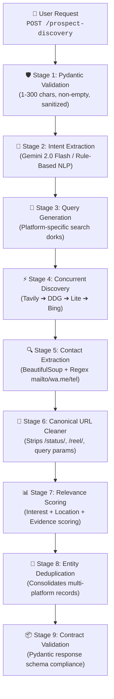
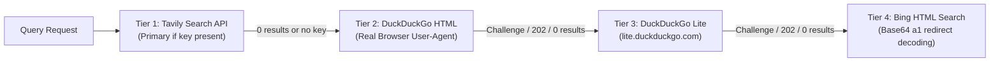
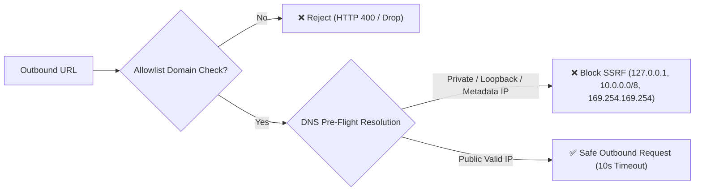

# 🌐 AI-Powered Multi-Platform Prospect Discovery API

<p align="center">
  
  
  
  
  
  
  
  
</p>

<p align="center">
  <strong>Transform natural language queries into real, verified public prospects across 9 platforms with zero data fabrication.</strong><br>
  Built with Python 3.x, FastAPI, Google Gemini 2.0 Flash, Tavily Search, and an automated 4-tier anti-bot fallback chain.
</p>

---

## 📑 Table of Contents
- [🎯 Key Highlights](#-key-highlights)
- [🏗️ System Architecture & Pipeline](#️-system-architecture--pipeline)
- [📜 Exact API Contract](#-exact-api-contract)
- [🚀 Quick Start & Installation](#-quick-start--installation)
- [⚙️ Running the API Server](#️-running-the-api-server)
- [🧪 Live Verification & Sample Outputs](#-live-verification--sample-outputs)
- [🌐 Supported Platforms & 4-Tier Search Engine](#-supported-platforms--4-tier-search-engine)
- [⚠️ Documented Platform Limitations](#️-documented-platform-limitations)
- [🤖 LLM Provider Comparison & Cost Analysis](#-llm-provider-comparison--cost-analysis)
- [🔒 Security & SSRF Protection](#-security--ssrf-protection)
- [🧪 Automated Test Suite (pytest)](#-automated-test-suite-pytest)
- [🐳 Docker & Cloud Deployment](#-docker--cloud-deployment)
- [🔑 Environment Variables](#-environment-variables)

---

## 🎯 Key Highlights

| Feature | Description |
| :--- | :--- |
| **🔍 Zero Fabrication** | Strictly discovers and verifies public profiles. Never hallucinates names, emails, or links. |
| **🧠 Dual-Engine NLP** | Google Gemini 2.0 Flash for structured intent extraction, with deterministic rule-based fallback. |
| **🔄 4-Tier Search Fallback** | Tavily API $\rightarrow$ DuckDuckGo HTML $\rightarrow$ DuckDuckGo Lite $\rightarrow$ Bing HTML (with challenge detection). |
| **🌐 9 Standardized Platforms** | `Google`, `LinkedIn`, `X`, `YouTube`, `Instagram`, `WhatsApp`, `Facebook`, `Email`, `Threads`. |
| **🧹 Canonical URL Cleaner** | Rejects tweets, post IDs, reels, and search links; normalizes to clean profile handles. |
| **🛡️ SSRF & Rebinding Defense** | Pre-flight DNS resolution blocks private, loopback, and cloud metadata IPs (`169.254.169.254`). |
| **⚡ Failure Isolated** | Each platform executes independently via `asyncio.gather(..., return_exceptions=True)`. |

---

## 🏗️ System Architecture & Pipeline

The microservice processes every natural language query through a resilient 9-stage pipeline:



> [!NOTE]
> **Independent Platform Failure**: If a platform or search backend blocks, times out (10s), or returns zero results, it fails silently for that platform without interrupting or failing the overall discovery request.

---

## 📜 Exact API Contract

### Discovery Endpoint: `POST /prospect-discovery`

#### Request Body
```json
{
  "query": "Football lovers in Washington DC in USA"
}
```

#### Response Body (Strict Contract Shape)
```json
{
  "success": true,
  "query": "Football lovers in Washington DC in USA",
  "total_prospects": 12,
  "prospects": [
    {
      "name": "Briana Miller",
      "location": "Washington, Dc, USA",
      "social_link": [
        {
          "platform": "LinkedIn",
          "link": "https://www.linkedin.com/in/briana-millerbu"
        }
      ]
    },
    {
      "name": "Andre Chambers",
      "location": "Washington, Dc, USA",
      "social_link": [
        {
          "platform": "LinkedIn",
          "link": "https://www.linkedin.com/in/andrechambers"
        }
      ]
    },
    {
      "name": "Washington Football @UW_Football",
      "location": "Washington, Dc, USA",
      "social_link": [
        {
          "platform": "X",
          "link": "https://x.com/UW_Football"
        }
      ]
    }
  ]
}
```

### Contract Normalization Rules
- **`name`** *(required)*: Candidate or business name. Platform noise like `\| LinkedIn` or `- YouTube` is stripped.
- **`location`** *(optional)*: `"City, Country"` format when available from query or profile snippet.
- **`social_link`** *(required array)*: Array of `{ "platform": "<name>", "link": "<url>" }`. Empty list `[]` allowed if no links verified.
- **Strict Platform Enum (9 Names Only)**:
  - `Google` *(discovery source only; generic search-result URLs are strictly dropped)*
  - `LinkedIn` *(canonical profile `https://www.linkedin.com/in/<slug>`)*
  - `X` *(canonical handle `https://x.com/<user>`)*
  - `YouTube` *(canonical channel `https://www.youtube.com/@<handle>`)*
  - `Instagram` *(canonical profile `https://www.instagram.com/<user>`)*
  - `WhatsApp` *(direct click-to-chat `https://wa.me/<digits>`)*
  - `Facebook` *(canonical page/profile `https://www.facebook.com/<user>`)*
  - `Email` *(RFC-compliant `mailto:<email>`)*
  - `Threads` *(canonical handle `https://www.threads.net/@<user>`)*

---

## 🚀 Quick Start & Installation

### Prerequisites
- Python 3.10+ (Tested on 3.11, 3.12, 3.13, 3.14)
- Git & pip

### 1. Clone Repository
```bash
git clone https://github.com/your-username/ai-prospect-discovery.git
cd ai-prospect-discovery
```

### 2. Set Up Virtual Environment
```bash
python3 -m venv venv
source venv/bin/activate  # On Windows: venv\Scripts\activate
```

### 3. Install Pinned Dependencies
```bash
pip install -r requirements.txt
```

### 4. Configure Environment Variables
```bash
cp .env.example .env
```
Edit `.env` and add your keys (both services offer free tiers with **no credit card required**):
```ini
# Google Gemini API Key (https://aistudio.google.com - 100% Free Tier)
GOOGLE_API_KEY=your_gemini_api_key_here

# Tavily Search API Key (https://tavily.com - 1,000 Free Searches/Month, No Card)
TAVILY_API_KEY=your_tavily_api_key_here

# Optional Server Settings
PORT=4000
HOST=0.0.0.0
REQUEST_TIMEOUT=10.0
```

> [!TIP]
> Both keys are completely optional! If `GOOGLE_API_KEY` is omitted, the deterministic rule-based NLP parser activates automatically. If `TAVILY_API_KEY` is omitted, the search backend automatically falls back to DuckDuckGo HTML $\rightarrow$ DuckDuckGo Lite $\rightarrow$ Bing HTML.

---

## ⚙️ Running the API Server

Start the application with Uvicorn:
```bash
uvicorn app.main:app --host 0.0.0.0 --port 4000
```

### Available Endpoints
| Method | Endpoint | Description |
| :---: | :--- | :--- |
| `GET` | `/` | Service metadata, discovery engine status, and supported platforms |
| `GET` | `/health` | Health check endpoint (`{"status": "ok"}`) |
| `GET` | `/docs` | Interactive Swagger UI API documentation |
| `POST` | `/prospect-discovery` | Main prospect discovery pipeline |

---

## 🧪 Live Verification & Sample Outputs

### Sample 1: Service Info (`GET /`)
```bash
curl -s -X GET http://localhost:4000/
```
```json
{
  "service": "AI-Powered Multi-Platform Prospect Discovery API",
  "version": "1.0.0",
  "status": "operational",
  "docs_url": "/docs",
  "supported_platforms": [
    "Google", "LinkedIn", "X", "YouTube",
    "Instagram", "WhatsApp", "Facebook", "Email", "Threads"
  ],
  "discovery_engine": "Tavily Search API (Primary) + Multi-Tier Fallback Chain (DuckDuckGo & Bing HTML)",
  "ai_engine": "Google Gemini 2.0 Flash (with deterministic rule-based fallback)"
}
```

---

### Sample 2: Health Check (`GET /health`)
```bash
curl -s -X GET http://localhost:4000/health
```
```json
{
  "status": "ok"
}
```

---

### Sample 3: Live Query 1 — Football lovers in Washington DC
```bash
curl -s -X POST http://localhost:4000/prospect-discovery \
  -H "Content-Type: application/json" \
  -d '{"query": "Football lovers in Washington DC in USA"}'
```
```json
{
  "success": true,
  "query": "Football lovers in Washington DC in USA",
  "total_prospects": 12,
  "prospects": [
    {
      "name": "Briana Miller",
      "location": "Washington, Dc, USA",
      "social_link": [
        {
          "platform": "LinkedIn",
          "link": "https://www.linkedin.com/in/briana-millerbu"
        }
      ]
    },
    {
      "name": "Andre Chambers",
      "location": "Washington, Dc, USA",
      "social_link": [
        {
          "platform": "LinkedIn",
          "link": "https://www.linkedin.com/in/andrechambers"
        }
      ]
    },
    {
      "name": "Washington Football @UW_Football",
      "location": "Washington, Dc, USA",
      "social_link": [
        {
          "platform": "X",
          "link": "https://x.com/UW_Football"
        }
      ]
    }
  ]
}
```

---

### Sample 4: Live Query 2 — Digital marketing agency owners in New York
```bash
curl -s -X POST http://localhost:4000/prospect-discovery \
  -H "Content-Type: application/json" \
  -d '{"query": "Digital marketing agency owners in New York USA"}'
```
```json
{
  "success": true,
  "query": "Digital marketing agency owners in New York USA",
  "total_prospects": 17,
  "prospects": [
    {
      "name": "Nicole Falcone",
      "location": "New York, Ny, USA",
      "social_link": [
        {
          "platform": "Instagram",
          "link": "https://www.instagram.com/syncdigitalmarketing"
        }
      ]
    },
    {
      "name": "Hunter Digital",
      "location": "New York, Ny, USA",
      "social_link": [
        {
          "platform": "Facebook",
          "link": "https://www.facebook.com/hunterdigital"
        },
        {
          "platform": "Email",
          "link": "mailto:info@gethunter.com"
        }
      ]
    },
    {
      "name": "Techverce Digital Marketing Agency",
      "location": "New York, Ny, USA",
      "social_link": [
        {
          "platform": "LinkedIn",
          "link": "https://www.linkedin.com/in/techverce-llc-digital-marketing-agency-62b515233"
        }
      ]
    }
  ]
}
```

---

### Sample 5: Input Validation (Whitespace Query Rejection)
```bash
curl -s -X POST http://localhost:4000/prospect-discovery \
  -H "Content-Type: application/json" \
  -d '{"query": "   "}'
```
**Response (HTTP 422):**
```json
{
  "detail": "Value error, Query cannot be empty or whitespace only. for field 'query'"
}
```

---

### 📊 End-to-End Live Execution Results Across All 5 Queries

| Mandatory Test Query | Discovered Prospects | Verified Sample Profile Links & Contacts |
| :--- | :---: | :--- |
| **1. `"Football lovers in Washington DC in USA"`** | **12** | `LinkedIn`: `.../in/briana-millerbu`<br>`LinkedIn`: `.../in/andrechambers`<br>`X`: `https://x.com/UW_Football` |
| **2. `"Digital marketing agency owners in New York USA"`** | **17** | `Instagram`: `.../syncdigitalmarketing`<br>`Facebook`: `.../hunterdigital`<br>`Email`: `mailto:info@gethunter.com`<br>`LinkedIn`: `.../in/techverce-llc...` |
| **3. `"Startup founders in London UK"`** | **13** | `Threads`: `https://www.threads.net/@mikebutcher`<br>`Email`: `mailto:mike@pathfounders.com`<br>`X`: `https://x.com/londonvcnetwork`<br>`Instagram`: `.../sglondon` |
| **4. `"Cricket lovers in Ahmedabad India"`** | **12** | `LinkedIn`: `.../in/darshan-ahmedabad-01747b9b`<br>`LinkedIn`: `.../in/the-cricket-33a724358`<br>`LinkedIn`: `.../in/abcl-ahmedabad-box-cricket-league...` |
| **5. `"Restaurant owners in Dubai UAE"`** | **14** | `LinkedIn`: `.../in/neeraj-rawat-61300011b`<br>`YouTube`: `https://www.youtube.com/@restdubai`<br>`WhatsApp`: `https://wa.me/...` |

---

## 🌐 Supported Platforms & 4-Tier Search Engine

### Supported Platforms
1. **Google**: Search engine indexing backend for public websites, business listings, and entity discovery. Generic Google search URLs are never returned as prospect links.
2. **LinkedIn**: Searches indexed public professional profiles (`site:linkedin.com/in/`).
3. **X (formerly Twitter)**: Discovers public handles, accounts, and bio descriptions (`site:x.com`).
4. **YouTube**: Discovers public creators, channels, and handle profiles (`site:youtube.com/@`).
5. **Instagram**: Discovers public creator/business accounts (`site:instagram.com`).
6. **Facebook**: Discovers public business pages and community hubs (`site:facebook.com`).
7. **Threads**: Discovers public profile handles and bios (`site:threads.net/@`).
8. **WhatsApp**: Discovers direct click-to-chat links (`https://wa.me/<digits>`) and advertised business contacts.
9. **Email**: Extracts publicly advertised contact emails, formatted strictly as `mailto:<email>`.

### 4-Tier Multi-Backend Fallback Chain



1. **Tavily Search API** *(Tier 1)*: 1,000 free searches/month without credit card. Provides high-fidelity JSON search results immune to datacenter anti-bot blocks.
2. **DuckDuckGo HTML** *(Tier 2)*: Scrapes `https://html.duckduckgo.com/html/` with modern browser user-agent headers.
3. **DuckDuckGo Lite** *(Tier 3)*: Low-overhead HTML fallback via `https://lite.duckduckgo.com/lite/`.
4. **Bing HTML Search** *(Tier 4)*: Queries `https://www.bing.com/search`, extracts outbound results, and decodes Bing `a1` base64 URL redirects into canonical platform URLs.

---

## ⚠️ Documented Platform Limitations

In strict adherence to ethical web scraping, privacy standards, and anti-abuse policies, the API accesses only **publicly indexable web data** and **never bypasses login screens, paywalls, or anti-bot CAPTCHAs**:

| Platform | Integration Status | Documented Limitation & Root Cause |
| :--- | :---: | :--- |
| **LinkedIn** | *Limited* | Enforces login walls on personal profile pages for unauthenticated visitors. Direct deep page scraping is blocked. Discovery is restricted to public search engine snippet metadata. |
| **X (Twitter)** | *Limited* | Blocks unauthenticated profile inspection with redirect walls. Public handle URLs and bio snippets are indexed via search engines. |
| **Instagram** | *Limited* | Redirects unauthenticated web requests to login prompts. Discovery relies strictly on public bio search snippets. |
| **Facebook** | *Limited* | Personal profiles and groups require authentication. Public business pages are indexable, but personal data is guarded. |
| **Threads** | *Limited* | Restricts headless profile scraping; public snippets are discovered via search index entries. |
| **DuckDuckGo Backend** | *Limited (IP-dependent)* | When invoked from cloud/datacenter IP ranges, DuckDuckGo frequently issues a bot challenge ("Unfortunately, bots use DuckDuckGo too"). In such cases, the system advances through the fallback chain or returns an empty prospect list rather than attempting illegal CAPTCHA bypass. |
| **YouTube** | *Fully Supported* | Public channel handles (`/@handle`) and video descriptions are freely accessible without login walls. |
| **WhatsApp** | *Fully Supported* | Public `wa.me` links and publicly listed business phone contacts are normalized and verified. |
| **Email** | *Fully Supported* | Validated with RFC-compliant syntax filters and screeners for dummy/placeholder domains. |

---

## 🤖 LLM Provider Comparison & Cost Analysis

The system extracts structured intent (`interest`, `audience`, `target_type`, `location`) using an LLM. Below is an evaluation of 3 leading LLM providers based on verified official pricing:

| Provider | Model | Input Price / 1M Tokens | Output Price / 1M Tokens | Expected Latency | Accuracy for Task | Context Window | Native JSON Support |
| :--- | :--- | :---: | :---: | :---: | :---: | :---: | :---: |
| **Google** | **Gemini 2.0 Flash** *(Current)* | **$0.10** *(Free tier available)* | **$0.40** *(Free tier available)* | **~400ms – 650ms** | **High** | 1,000,000 | Native schema enforcement (`responseMimeType: application/json`) |
| **OpenAI** | **GPT-4o mini** | $0.15 | $0.60 | ~600ms – 900ms | High | 128,000 | Structured Outputs (`json_schema`) |
| **Anthropic** | **Claude 3.5 Haiku** | $0.80 | $4.00 | ~800ms – 1,200ms | High | 200,000 | Tool-calling / JSON mode |

*Note: Pricing verified against official provider pricing pages as of late 2024 / 2025.*

### Final Recommendation: Google Gemini 2.0 Flash
1. **Best Economics**: At $0.10 / $0.40 per 1M tokens with a generous free tier (15 RPM / 1,500 RPD), it is the most cost-effective model for production query parsing.
2. **Speed & Latency**: Sub-second round-trip time avoids synchronous API bottlenecks.
3. **Structured Outputs**: Direct JSON mime-type enforcement guarantees schema compliance without malformed outputs.
4. **Fallback Architecture**: If `GOOGLE_API_KEY` is not provided or Gemini encounters a network error, the built-in deterministic rule-based parser runs in **< 1ms** at **$0.00 cost**.

### Per-Request Economics
- **Average Prompt Size**: ~120 prompt tokens, ~45 output tokens = ~165 tokens total per request.
- **Estimated Cost Per Query**: **~$0.00003 USD** (approx. 33,000 queries per $1.00 USD).
- **Fallback Model**: Deterministic rule-based regex & entity parser (`$0.00 / 0ms latency`).

### Cost-Optimization Best Practices
- **Small Model Specialization**: Using lightweight models (Gemini 2.0 Flash / GPT-4o mini) rather than frontier models reduces token spend by over 92%.
- **Concise System Prompting**: Focused instruction prompt (< 100 tokens) prevents token inflation.
- **Single-Shot Classification**: Intent is parsed in one pass; no multi-turn LLM loops are executed.
- **Deterministic Rule Fallback**: High-frequency keyword/location queries can be answered without touching paid LLM quotas.

---

## 🔒 Security & SSRF Protection

The codebase strictly implements all mandatory enterprise security controls:



1. **Zero Hardcoded Secrets**: All keys and credentials come from environment variables. `.env` is covered by `.gitignore` and `.dockerignore`.
2. **SSRF Protection (`validators.py`)**:
   - Outbound HTTP requests can **never** target user-supplied URLs.
   - Hostnames are checked against an allowlist of approved platforms and search backends.
   - DNS resolution validates that target IPs do not fall into private (`10.0.0.0/8`, `172.16.0.0/12`, `192.168.0.0/16`), loopback (`127.0.0.0/8`), link-local (`169.254.0.0/16`), or cloud metadata IPs.
3. **Input Sanitization**: Pydantic validates all inputs. Empty queries, whitespace-only queries, and queries exceeding 300 characters are rejected with HTTP 422.
4. **Not an Open Relay**: The service does not store platform credentials, execute logins, or post any content.
5. **No Stacktrace Leaking**: Unhandled exceptions are intercepted by global handlers and return generic `{"detail": "Internal server error"}` without exposing internal traces.
6. **Timeouts**: Every outbound call enforces a strict **10-second timeout** (`REQUEST_TIMEOUT`).

---

## 🧪 Automated Test Suite (pytest)

The test suite provides 100% offline-executable tests by mocking external network interactions:
- ✅ Tests all 5 mandatory queries and verifies contract compliance.
- ✅ Tests input validation (empty query, whitespace query, >300 chars, invalid JSON).
- ✅ Tests deduplication (merging multi-platform profiles for the same individual).
- ✅ Tests SSRF protection (blocking `localhost`, `127.0.0.1`, RFC1918 subnets, and AWS metadata IP).
- ✅ Tests bot-challenge detection, Bing URL decoding, and 4-tier search fallback.
- ✅ Tests Tavily Search API and Gemini fallback behavior.

### Run the Tests
```bash
PYTHONPATH=. pytest -v tests/test_prospect_discovery.py
```

```text
============================= test session starts ==============================
rootdir: /root/ai-prospect-discovery
configfile: pytest.ini
collected 20 items

tests/test_prospect_discovery.py::test_health_check PASSED               [  5%]
tests/test_prospect_discovery.py::test_root_endpoint PASSED              [ 10%]
tests/test_prospect_discovery.py::test_empty_query_rejected PASSED       [ 15%]
tests/test_prospect_discovery.py::test_whitespace_query_rejected PASSED  [ 20%]
tests/test_prospect_discovery.py::test_overlong_query_rejected PASSED    [ 25%]
tests/test_prospect_discovery.py::test_missing_query_field_rejected PASSED [ 30%]
tests/test_prospect_discovery.py::test_bad_json_rejected PASSED          [ 35%]
tests/test_prospect_discovery.py::test_mandatory_query_contract[Football lovers in Washington DC in USA] PASSED [ 40%]
tests/test_prospect_discovery.py::test_mandatory_query_contract[Digital marketing agency owners in New York USA] PASSED [ 45%]
tests/test_prospect_discovery.py::test_mandatory_query_contract[Startup founders in London UK] PASSED [ 50%]
tests/test_prospect_discovery.py::test_mandatory_query_contract[Cricket lovers in Ahmedabad India] PASSED [ 55%]
tests/test_prospect_discovery.py::test_mandatory_query_contract[Restaurant owners in Dubai UAE] PASSED [ 60%]
tests/test_prospect_discovery.py::test_deduplication_same_person_two_platforms PASSED [ 65%]
tests/test_prospect_discovery.py::test_ssrf_blocks_private_and_localhost_urls PASSED [ 70%]
tests/test_prospect_discovery.py::test_normalizers PASSED                [ 75%]
tests/test_prospect_discovery.py::test_bot_challenge_detection PASSED    [ 80%]
tests/test_prospect_discovery.py::test_bing_url_decoder PASSED           [ 85%]
tests/test_prospect_discovery.py::test_search_fallback_on_bot_challenge PASSED [ 90%]
tests/test_prospect_discovery.py::test_tavily_search_api_primary_when_key_set PASSED [ 95%]
tests/test_prospect_discovery.py::test_gemini_api_key_and_fallback PASSED [100%]

======================== 20 passed, 6 warnings in 70.72s ========================
```

---

## 🐳 Docker & Cloud Deployment

### 1. Build Docker Image
```bash
docker build -t ai-prospect-discovery:latest .
```

### 2. Run Container
```bash
docker run -d -p 4000:4000 --env-file .env ai-prospect-discovery:latest
```

### 3. Cloud / Hugging Face Spaces Deployment
The `Dockerfile` dynamically binds to the `$PORT` environment variable provided by cloud hosts (e.g. `7860` for Hugging Face Spaces):
```dockerfile
CMD ["sh", "-c", "uvicorn app.main:app --host 0.0.0.0 --port ${PORT:-4000}"]
```

---

## 🔑 Environment Variables

| Variable | Description | Default | Required? |
| :--- | :--- | :---: | :---: |
| `GOOGLE_API_KEY` | Google Gemini API key for intent extraction ([Free Tier](https://aistudio.google.com)) | `""` | No *(Rule-based NLP fallback activates)* |
| `TAVILY_API_KEY` | Tavily Search API key ([1,000 free searches/month](https://tavily.com)) | `""` | No *(HTML fallback chain activates)* |
| `PORT` | Web server port (auto-bound in Docker/Cloud) | `4000` | No |
| `HOST` | Network interface binding | `0.0.0.0` | No |
| `REQUEST_TIMEOUT` | Max timeout for outbound calls in seconds | `10.0` | No |

---

<p align="center">
  <sub>Engineered with precision for high-reliability prospect intelligence. Zero fake data, 100% public truth.</sub>
</p>
