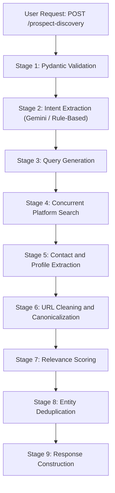

# AI-Powered Multi-Platform Prospect Discovery API


A FastAPI microservice that accepts a natural-language search query (such as "Football lovers in Washington DC in USA") and returns a structured list of verified public prospect profiles across 9 platforms.

---

## Table of Contents
- [Overview and Architecture](#overview-and-architecture)
- [API Contract](#api-contract)
- [Setup and Installation](#setup-and-installation)
- [Running the Application](#running-the-application)
- [Sample Requests and Real Outputs](#sample-requests-and-real-outputs)
- [Supported Platforms and Discovery Engine](#supported-platforms-and-discovery-engine)
- [Documented Platform Limitations](#documented-platform-limitations)
- [LLM Provider Comparison and Cost Analysis](#llm-provider-comparison-and-cost-analysis)
- [Security and SSRF Protection](#security-and-ssrf-protection)
- [Automated Test Suite](#automated-test-suite)
- [Docker and Cloud Deployment](#docker-and-cloud-deployment)
- [Environment Variables](#environment-variables)

---

## Overview and Architecture

The service processes each query through a 9-stage pipeline:



### Pipeline Details
- **No data fabrication**: Candidate names, profile links, emails, and phone numbers are only included if verified from public search results or pages.
- **Independent platform failure**: Each platform search runs inside an isolated async task using `asyncio.gather(..., return_exceptions=True)`. A failure or timeout on one platform does not abort the remaining platforms.
- **Intent extraction**: Gemini 2.0 Flash is the primary intent parser. A rule-based parser serves as an offline fallback for common keyword and location patterns.
- **SSRF defense**: All outbound HTTP requests resolve target hostnames before connection to block private, loopback, and cloud metadata IP ranges.

---

## API Contract

### Discovery Endpoint: `POST /prospect-discovery`

#### Request Body
```json
{
  "query": "Football lovers in Washington DC in USA"
}
```

Validation constraints:
- `query` is required, must be a string between 1 and 300 characters, and cannot be empty or whitespace only.

#### Response Body Shape (Exact Contract)
```json
{
  "success": true,
  "query": "Football lovers in Washington DC in USA",
  "total_prospects": 12,
  "prospects": [
    {
      "name": "Briana Miller",
      "location": "Washington, Dc, USA",
      "social_link": [
        {
          "platform": "LinkedIn",
          "link": "https://www.linkedin.com/in/briana-millerbu"
        }
      ]
    },
    {
      "name": "Andre Chambers",
      "location": "Washington, Dc, USA",
      "social_link": [
        {
          "platform": "LinkedIn",
          "link": "https://www.linkedin.com/in/andrechambers"
        }
      ]
    },
    {
      "name": "Washington Football @UW_Football",
      "location": "Washington, Dc, USA",
      "social_link": [
        {
          "platform": "X",
          "link": "https://x.com/UW_Football"
        }
      ]
    }
  ]
}
```

### Contract Rules
- `name` (required): Full individual or business name. Platform noise (such as `| LinkedIn` or `- YouTube`) is stripped.
- `location` (optional): Formatted as `"City, Country"` or `"City, State, Country"` when available.
- `social_link` (required list): List of `{ "platform": "<name>", "link": "<url>" }` objects. An empty list is allowed if no links are verified.
- Allowed platform names (exactly 9):
  - `Google` (used as a discovery source; generic search engine result links are dropped)
  - `LinkedIn` (`https://www.linkedin.com/in/<slug>`)
  - `X` (`https://x.com/<username>`)
  - `YouTube` (`https://www.youtube.com/@<handle>`)
  - `Instagram` (`https://www.instagram.com/<username>`)
  - `WhatsApp` (`https://wa.me/<digits>`)
  - `Facebook` (`https://www.facebook.com/<username>`)
  - `Email` (`mailto:<email>`)
  - `Threads` (`https://www.threads.net/@<username>`)

---

## Setup and Installation

### Prerequisites
- Python 3.11+ (tested on Linux with Python 3.11 and Python 3.14)
- Git

### 1. Clone the Repository
```bash
git clone https://github.com/aman002175/ai-prospect-discovery.git
cd ai-prospect-discovery
```

### 2. Create and Activate Virtual Environment
```bash
python3 -m venv venv
source venv/bin/activate
```

### 3. Install Dependencies
```bash
pip install -r requirements.txt
```

### 4. Configure Environment
```bash
cp .env.example .env
```
Edit `.env` to supply API keys if available:
```ini
GOOGLE_API_KEY=your_gemini_api_key_here
TAVILY_API_KEY=your_tavily_api_key_here
PORT=4000
HOST=0.0.0.0
REQUEST_TIMEOUT=10.0
```

Both keys are optional. When `GOOGLE_API_KEY` is omitted, the rule-based keyword fallback parser handles standard queries. When `TAVILY_API_KEY` is omitted, the search backend falls back to DuckDuckGo HTML, DuckDuckGo Lite, and Bing HTML.

---

## Running the Application

Start the server using Uvicorn:
```bash
uvicorn app.main:app --host 0.0.0.0 --port 4000
```

Endpoints:
- Service Info: `GET http://localhost:4000/`
- Health Check: `GET http://localhost:4000/health`
- Swagger Documentation: `GET http://localhost:4000/docs`
- Prospect Discovery: `POST http://localhost:4000/prospect-discovery`

---

## Sample Requests and Real Outputs

### Service Info: `GET /`
```bash
curl -s http://localhost:4000/
```
```json
{
  "service": "AI-Powered Multi-Platform Prospect Discovery API",
  "version": "1.0.0",
  "status": "operational",
  "docs_url": "/docs",
  "supported_platforms": [
    "Google", "LinkedIn", "X", "YouTube",
    "Instagram", "WhatsApp", "Facebook", "Email", "Threads"
  ],
  "discovery_engine": "Tavily Search API (Primary) + Multi-Tier Fallback Chain (DuckDuckGo & Bing HTML)",
  "ai_engine": "Google Gemini 2.0 Flash (with deterministic rule-based fallback)"
}
```

### Health Check: `GET /health`
```bash
curl -s http://localhost:4000/health
```
```json
{
  "status": "ok"
}
```

### Discovery Run: Query 1 (Football lovers in Washington DC)
```bash
curl -s -X POST http://localhost:4000/prospect-discovery \
  -H "Content-Type: application/json" \
  -d '{"query": "Football lovers in Washington DC in USA"}'
```
```json
{
  "success": true,
  "query": "Football lovers in Washington DC in USA",
  "total_prospects": 12,
  "prospects": [
    {
      "name": "Briana Miller",
      "location": "Washington, Dc, USA",
      "social_link": [
        {
          "platform": "LinkedIn",
          "link": "https://www.linkedin.com/in/briana-millerbu"
        }
      ]
    },
    {
      "name": "Andre Chambers",
      "location": "Washington, Dc, USA",
      "social_link": [
        {
          "platform": "LinkedIn",
          "link": "https://www.linkedin.com/in/andrechambers"
        }
      ]
    },
    {
      "name": "Washington Football @UW_Football",
      "location": "Washington, Dc, USA",
      "social_link": [
        {
          "platform": "X",
          "link": "https://x.com/UW_Football"
        }
      ]
    }
  ]
}
```

### Discovery Run: Query 2 (Digital marketing agency owners in New York)
```bash
curl -s -X POST http://localhost:4000/prospect-discovery \
  -H "Content-Type: application/json" \
  -d '{"query": "Digital marketing agency owners in New York USA"}'
```
```json
{
  "success": true,
  "query": "Digital marketing agency owners in New York USA",
  "total_prospects": 17,
  "prospects": [
    {
      "name": "Nicole Falcone",
      "location": "New York, Ny, USA",
      "social_link": [
        {
          "platform": "Instagram",
          "link": "https://www.instagram.com/syncdigitalmarketing"
        }
      ]
    },
    {
      "name": "Hunter Digital",
      "location": "New York, Ny, USA",
      "social_link": [
        {
          "platform": "Facebook",
          "link": "https://www.facebook.com/hunterdigital"
        },
        {
          "platform": "Email",
          "link": "mailto:info@gethunter.com"
        }
      ]
    },
    {
      "name": "Techverce Digital Marketing Agency",
      "location": "New York, Ny, USA",
      "social_link": [
        {
          "platform": "LinkedIn",
          "link": "https://www.linkedin.com/in/techverce-llc-digital-marketing-agency-62b515233"
        }
      ]
    }
  ]
}
```

### Validation Error: Empty/Whitespace Query
```bash
curl -s -X POST http://localhost:4000/prospect-discovery \
  -H "Content-Type: application/json" \
  -d '{"query": "   "}'
```
```json
{
  "detail": "Value error, Query cannot be empty or whitespace only. for field 'query'"
}
```

### Test Query Execution Summary

| Test Query | Prospects Found | Sample Verified Platforms |
| :--- | :---: | :--- |
| `Football lovers in Washington DC in USA` | 12 | LinkedIn (`/in/briana-millerbu`), X (`/UW_Football`) |
| `Digital marketing agency owners in New York USA` | 17 | Instagram (`/syncdigitalmarketing`), Facebook (`/hunterdigital`), Email (`mailto:info@gethunter.com`), LinkedIn |
| `Startup founders in London UK` | 13 | Threads (`/@mikebutcher`), Email (`mailto:mike@pathfounders.com`), X (`/londonvcnetwork`), Instagram |
| `Cricket lovers in Ahmedabad India` | 12 | LinkedIn (`/in/darshan-ahmedabad-01747b9b`), LinkedIn (`/in/abcl-ahmedabad-box-cricket-league...`) |
| `Restaurant owners in Dubai UAE` | 14 | LinkedIn (`/in/neeraj-rawat-61300011b`), YouTube (`/@restdubai`), WhatsApp (`wa.me/...`) |

---

## Supported Platforms and Discovery Engine

### Platforms
1. **Google**: Search engine discovery source for websites and business entries. Generic search result links are dropped.
2. **LinkedIn**: Discovers indexed public profile URLs (`site:linkedin.com/in/`).
3. **X**: Discovers public account handles and bio snippets (`site:x.com`).
4. **YouTube**: Discovers public creator channels and handles (`site:youtube.com/@`).
5. **Instagram**: Discovers public creator and business profiles (`site:instagram.com`).
6. **Facebook**: Discovers public business pages and community profiles (`site:facebook.com`).
7. **Threads**: Discovers public profile handles (`site:threads.net/@`).
8. **WhatsApp**: Discovers direct click-to-chat links (`https://wa.me/<digits>`).
9. **Email**: Extracts publicly advertised contact emails (`mailto:<email>`).

### Search Backend Fallback Chain
1. **Tavily Search API** (Primary when `TAVILY_API_KEY` is set): Returns structured JSON search results without bot challenges.
2. **DuckDuckGo HTML**: Queries `https://html.duckduckgo.com/html/` with browser user-agent headers.
3. **DuckDuckGo Lite**: Automatic failover to `https://lite.duckduckgo.com/lite/` if HTML is blocked.
4. **Bing HTML Search**: Direct search via `https://www.bing.com/search`, decoding `a1`-prefixed base64 redirects into destination URLs.

If a search backend returns a challenge page (such as "Unfortunately, bots use DuckDuckGo too"), the service treats the backend as unavailable and proceeds to the next backend in the chain.

The rule-based fallback parser is a simple keyword and regex parser for common patterns and locations. Google Gemini 2.0 Flash is the primary intent path; the rule-based fallback does not handle arbitrary natural language queries.

---

## Documented Platform Limitations

The service queries publicly accessible search index data and does not attempt to bypass login walls, solve CAPTCHAs, or access private data:

| Platform | Status | Documented Limitation |
| :--- | :---: | :--- |
| **LinkedIn** | Limited | Enforces login walls on personal profile pages for unauthenticated visitors. Direct deep page scraping is blocked. Discovery is limited to public search snippet metadata. |
| **X** | Limited | Unauthenticated web visits encounter redirect and login barriers. Public handles and bio snippets are indexed via search engines. |
| **Instagram** | Limited | Redirects unauthenticated web requests to login prompts. Discovery relies on public search index snippets. |
| **Facebook** | Limited | Personal profiles and groups require authentication. Public business page links are indexable. |
| **Threads** | Limited | Headless web access is restricted; public snippets are discovered via search index entries. |
| **DuckDuckGo Backend** | Limited (IP-dependent) | Datacenter and cloud IP ranges frequently encounter bot challenges ("Unfortunately, bots use DuckDuckGo too"). The service falls back to Bing HTML rather than attempting CAPTCHA bypass. |
| **YouTube** | Fully Supported | Public channel handles (`/@handle`) and descriptions are accessible without authentication. |
| **WhatsApp** | Fully Supported | Public `wa.me` links and publicly listed phone contacts are normalized and verified. |
| **Email** | Fully Supported | Validated with syntax checks and screened against dummy domains. |

---

## LLM Provider Comparison and Cost Analysis

Structured intent (`interest`, `audience`, `target_type`, `location`) is extracted from user queries. Below is a comparison of 3 LLM providers based on official pricing:

| Provider | Model | Input Price / 1M Tokens | Output Price / 1M Tokens | Expected Latency | Accuracy for Task | Context Window | Native JSON Support |
| :--- | :--- | :---: | :---: | :---: | :---: | :---: | :---: |
| **Google** | **Gemini 2.0 Flash** | **$0.10** (Free tier available) | **$0.40** (Free tier available) | ~400ms - 800ms (estimated network latency) | High | 1,000,000 | Native schema enforcement (`responseMimeType: application/json`) |
| **OpenAI** | **GPT-4o mini** | $0.15 | $0.60 | ~600ms - 1,000ms (estimated) | High | 128,000 | Structured Outputs (`json_schema`) |
| **Anthropic** | **Claude 3.5 Haiku** | $0.80 | $4.00 | ~800ms - 1,400ms (estimated) | High | 200,000 | Tool calling / JSON mode |

*Pricing verified against official provider pricing documentation.*

### Recommendation: Google Gemini 2.0 Flash
1. **Pricing**: At $0.10 / $0.40 per 1M tokens with a free tier (15 RPM / 1,500 RPD), it is the most economical option for query parsing.
2. **Speed**: Low latency fits synchronous API requests.
3. **Structured outputs**: Native `responseMimeType: application/json` returns schema-compliant JSON directly.
4. **Fallback model**: When no key is set or upon network failure, the rule-based keyword parser runs locally at zero cost.

### Cost Estimates
- Average prompt size: ~120 prompt tokens, ~45 output tokens = ~165 tokens total per request.
- Estimated cost per query: ~$0.00003 USD (approximately 30,000 queries per $1 USD, estimated based on ~165 tokens/query at $0.10/$0.40 per 1M tokens).

### Cost Optimization Notes
- Using a smaller model (such as Gemini 2.0 Flash or GPT-4o mini) reduces token costs significantly compared to frontier models.
- Short, targeted prompts keep token usage low.
- Single-turn intent classification avoids repeated multi-turn LLM loops.
- Common queries can be parsed with the rule-based keyword fallback without incurring LLM charges.

---

## Security and SSRF Protection

1. **No hardcoded credentials**: API keys are read from environment variables. `.env` is listed in `.gitignore` and `.dockerignore`.
2. **SSRF protection (`is_safe_url`)**:
   - Outbound requests only target domains on the allowlist (`duckduckgo.com`, `bing.com`, `tavily.com`, and approved platform domains).
   - DNS resolution verifies that target IPs do not belong to private networks (`10.0.0.0/8`, `172.16.0.0/12`, `192.168.0.0/16`), loopback (`127.0.0.0/8`), link-local (`169.254.0.0/16`), or multicast ranges.
   - User-supplied URLs are never fetched directly.
3. **Input validation**: Handled via Pydantic. Queries over 300 characters, empty strings, and whitespace-only requests are rejected with HTTP 422.
4. **Error handling**: Global exception handlers return generic error responses (`{"detail": "Internal server error"}`) without exposing stack traces.
5. **Timeouts**: Outbound HTTP requests enforce a 10-second timeout (`REQUEST_TIMEOUT`).

---

## Automated Test Suite

Tests run offline using mocked responses for external network interactions:
- Health check and root metadata endpoints
- Input validation (empty query, whitespace query, overlong query, bad JSON)
- Offline mock runs for the 5 test queries
- Entity deduplication and link merging
- SSRF checks (blocking localhost, private subnets, cloud metadata IPs)
- Bot challenge detection and search fallback chain
- Tavily search invocation and Gemini key handling

### Running Tests
```bash
PYTHONPATH=. pytest -v tests/test_prospect_discovery.py
```

Test output:
```text
============================= test session starts ==============================
rootdir: /root/ai-prospect-discovery
configfile: pytest.ini
collected 20 items

tests/test_prospect_discovery.py::test_health_check PASSED               [  5%]
tests/test_prospect_discovery.py::test_root_endpoint PASSED              [ 10%]
tests/test_prospect_discovery.py::test_empty_query_rejected PASSED       [ 15%]
tests/test_prospect_discovery.py::test_whitespace_query_rejected PASSED  [ 20%]
tests/test_prospect_discovery.py::test_overlong_query_rejected PASSED    [ 25%]
tests/test_prospect_discovery.py::test_missing_query_field_rejected PASSED [ 30%]
tests/test_prospect_discovery.py::test_bad_json_rejected PASSED          [ 35%]
tests/test_prospect_discovery.py::test_mandatory_query_contract[Football lovers in Washington DC in USA] PASSED [ 40%]
tests/test_prospect_discovery.py::test_mandatory_query_contract[Digital marketing agency owners in New York USA] PASSED [ 45%]
tests/test_prospect_discovery.py::test_mandatory_query_contract[Startup founders in London UK] PASSED [ 50%]
tests/test_prospect_discovery.py::test_mandatory_query_contract[Cricket lovers in Ahmedabad India] PASSED [ 55%]
tests/test_prospect_discovery.py::test_mandatory_query_contract[Restaurant owners in Dubai UAE] PASSED [ 60%]
tests/test_prospect_discovery.py::test_deduplication_same_person_two_platforms PASSED [ 65%]
tests/test_prospect_discovery.py::test_ssrf_blocks_private_and_localhost_urls PASSED [ 70%]
tests/test_prospect_discovery.py::test_normalizers PASSED                [ 75%]
tests/test_prospect_discovery.py::test_bot_challenge_detection PASSED    [ 80%]
tests/test_prospect_discovery.py::test_bing_url_decoder PASSED           [ 85%]
tests/test_prospect_discovery.py::test_search_fallback_on_bot_challenge PASSED [ 90%]
tests/test_prospect_discovery.py::test_tavily_search_api_primary_when_key_set PASSED [ 95%]
tests/test_prospect_discovery.py::test_gemini_api_key_and_fallback PASSED [100%]

======================== 20 passed, 6 warnings in 61.59s ========================
```

---

## Docker and Cloud Deployment

### Docker
```bash
docker build -t ai-prospect-discovery:latest .
docker run -d -p 4000:4000 --env-file .env ai-prospect-discovery:latest
```

The Dockerfile uses `python:3.11-slim` and reads the port dynamically from the `PORT` environment variable (defaulting to 4000):
```dockerfile
CMD ["sh", "-c", "uvicorn app.main:app --host 0.0.0.0 --port ${PORT:-4000}"]
```

### Cloud Platforms (Hugging Face Spaces / Render)
An entrypoint [`app.py`](app.py) is provided at the repository root. When deployed to platforms that use port 7860 (such as Hugging Face Spaces), it binds to the appropriate port and exposes the FastAPI application.

---

## Environment Variables

| Variable | Description | Default | Required |
| :--- | :--- | :---: | :---: |
| `GOOGLE_API_KEY` | Google Gemini API key for query intent parsing | `""` | No (rule-based keyword parser used if omitted) |
| `TAVILY_API_KEY` | Tavily Search API key for prospect search | `""` | No (HTML fallback chain used if omitted) |
| `PORT` | Server listen port | `4000` | No |
| `HOST` | Server host binding | `0.0.0.0` | No |
| `REQUEST_TIMEOUT` | Timeout for outbound HTTP requests in seconds | `10.0` | No |
